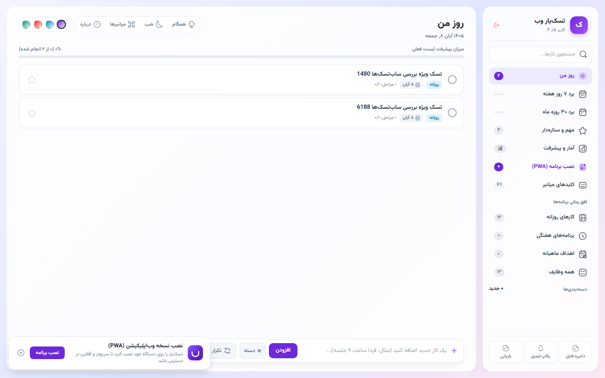
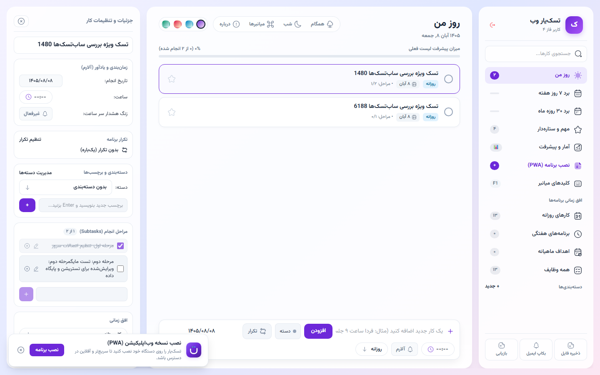
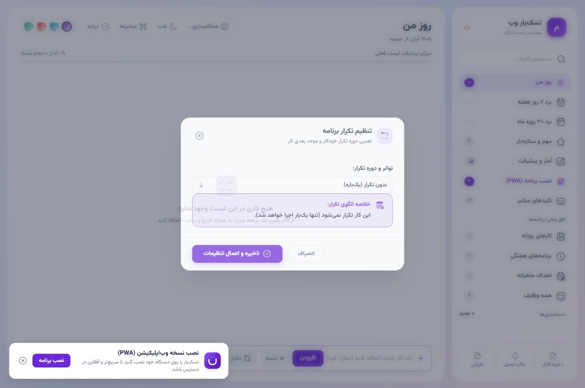
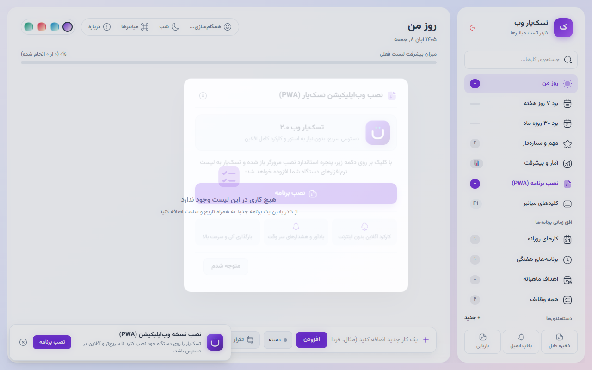
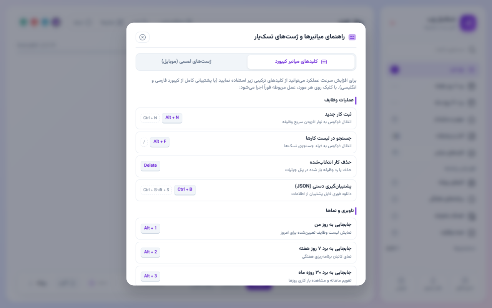

<div align="center">

# 📋 تسک‌یار وب ۲.۰ (TaskYar Web)
### سامانه مدرن، سریع و پیشرو مدیریت وظایف و برنامه‌ریزی روزانه با تقویم شمسی (PWA)

[](https://laravel.com)
[](https://php.net)
[](https://vuejs.org)
[](https://pinia.vuejs.org)
[](https://tailwindcss.com)
[](https://web.dev/progressive-web-apps/)
[](LICENSE)

[🌐 وب‌سایت آنلاین](https://taskyar.3aw.ir) • [📥 دانلود آخرین نسخه پایدار (Releases)](../../releases) • [📖 مستندات جامع](docs/) • [🐛 گزارش خطا](../../issues)

</div>

---

## 📖 ۱. معرفی پروژه (Introduction)

**تسک‌یار وب ۲.۰ (TaskYar Web)** یک سامانه نرم‌افزاری مدرن، متن‌باز و همه‌جانبه برای مدیریت کارهای روزانه، هفتگی و ماهانه بر پایه **تقویم خورشیدی (جلالی)**، زبان فارسی و اصول طراحی ارگونومیک راست‌چین (RTL) است.

### چه نیازی را برطرف می‌کند؟
بسیاری از نرم‌افزارهای خارجی مدیریت تسک (مانند Todoist یا TickTick) یا فاقد پشتیبانی از تقویم شمسی هستند، یا نیاز به پرداخت دلاری و اشتراک ماهانه دارند، یا به دلیل تحریم و فیلترینگ با اختلال روبه‌رو می‌شوند. تسک‌یار وب برای ارائه **یک بستر کاملاً مستقل، محلی و ابری با سرعت فوق‌العاده** طراحی شده است.

### تفاوت نسخه وب ۲.۰ با نسخه قدیمی دسکتاپ:
نسخه اولیه تسک‌یار یک نرم‌افزار تک‌کاربره مبتنی بر فریم‌ورک Electron برای دسکتاپ بود که امکان اشتراک‌گذاری داده‌ها روی چند دستگاه را نداشت. **نسخه وب ۲.۰** با بازنویسی کامل معماری، مزایای زیر را فراهم ساخته است:
- **دسترسی چندسکویی (Cross-Platform):** استفاده در موبایل، تبلت و کامپیوتر بدون محدودیت سیستم‌عامل.
- **حساب‌های کاربری ایزوله (Multi-Tenant Architecture):** فضای کاری کاملاً امن و اختصاصی برای هر کاربر با رمزنگاری مدرن.
- **وب‌اپلیکیشن پیشرو (PWA) با کارکرد آفلاین:** امکان نصب مستقیم به عنوان نرم‌افزار بدون استور و کارکرد حتی در زمان قطعی کامل اینترنت.
- **استقرار روی هاست اشتراکی:** بهینه‌سازی دقیق جهت اجرا با کمترین منابع بر روی کنترل‌پنل‌های رایج نظیر DirectAdmin و cPanel.

---

## ✨ ۲. قابلیت‌های اصلی (Key Features)

- 📅 **نماهای بصری و کارآمد:**
  - **روز من (`Alt+1`):** تمرکز بدون حواس‌پرتی روی برنامه‌های روز جاری.
  - **برد ۷ روز هفته (`Alt+2`):** سازمان‌دهی افقی کارهای شنبه تا جمعه.
  - **برد ۳۰ روزه ماه (`Alt+3`):** تقویم کامل ماهیانه برای مشاهده دورنمای رویدادها.
  - **کارهای مهم (`Alt+4`) و همه وظایف (`Alt+8`):** فیلتر و جستجوی لحظه‌ای (`Alt+F`).
- 🔁 **موتور قدرتمند کارهای تکرارشونده (Recurrence Engine):**
  - تنظیم دوره تکرار روزانه، هفتگی (انتخاب روزهای مشخص)، ماهانه و سالانه.
  - مدیریت استثنائات تکرار (رد کردن یک مورد، ویرایش مستقل یک رخداد، یا تغییر موارد بعدی).
- 🪜 **سیستم مراحل فرعی (Subtasks):**
  - ثبت سریع با کلید Enter، به‌روزرسانی آنی و زودهنگام رابط کاربری (Optimistic UI).
  - شمارنده پیشرفت هوشمند (`مراحل انجام (X از Y)`) و ویرایش درون‌خطی (Inline Edit).
- 🏷️ **دسته‌بندی و برچسب‌گذاری (Categories & Tags):**
  - دسته‌های دارای نشانگر رنگی و سیستم هشتگ‌گذاری موضوعی نامحدود.
- ⏰ **انتخاب‌گرهای بومی جلالی:**
  - تقویم ماهانه شمسی و انتخاب‌گر ۲۴ ساعته زمان با تبدیل خودکار به باتم‌شیت در موبایل.
- ⚡ **کلیدهای میانبر فراگیر (Keyboard Shortcuts):**
  - ناوبری کامل با کیبورد (`Alt+1..8`, `Alt+N`, `Alt+F`, `F1`, `Esc`) و راهنمای ژست‌های لمسی موبایل.
- 📴 **کارکرد آفلاین با دیتابیس محلی (IndexedDB):**
  - ذخیره‌سازی محلی وظایف در مرورگر و همگام‌سازی دوطرفه خودکار پس از اتصال اینترنت.
- 🎨 **طراحی چشم‌نواز و تم‌ها:**
  - تم روشن و تاریک استاندارد، تایپوگرافی محلی وزیرمتن (بدون CDN) و سازگاری کامل از عرض ۳۲۰px تا ۱۴۴۰px.

---

## 📸 ۳. تصاویر رابط کاربری (Screenshots)

<div align="center">

### نمای دسکتاپ و مدیریت وظایف


### کشوی تنظیمات کار و مراحل فرعی (Subtasks)


### پنجره تنظیمات پیشرفته تکرار کارها (Recurrence Modal)


### راهنمای هوشمند نصب وب‌اپلیکیشن (PWA Install Modal)


### راهنمای کلیدهای میانبر و ژست‌های لمسی موبایل


</div>

---

## 🛠️ ۴. استک فناوری (Technology Stack)

| بخش | فناوری‌های به‌کار رفته |
| :--- | :--- |
| **Backend** | **Laravel 11/12** (PHP 8.4, Eloquent ORM, Sanctum/Session Auth, Laravel Pint) |
| **Frontend** | **Vue 3** (Composition API, `<script setup>`), **Pinia** (State Management) |
| **Bundler & CSS**| **Vite 8**, **Tailwind CSS**, PostCSS, Autoprefixer |
| **PWA & Offline**| **Service Worker** (`sw.js`), **Web Manifest**, **IndexedDB** Client Storage |
| **Database** | **MariaDB 10.6+** / **MySQL 8.0+** (پشتیبانی صریح از انجین **InnoDB**) |
| **Typography** | فونت فارسی **وزیرمتن (Vazirmatn)** به صورت WOFF2 محلی (بدون CDN) |
| **Deployment** | سازگار با هاست‌های اشتراکی **DirectAdmin** و cPanel |

---

## 🏗️ ۵. معماری و مهندسی سیستم (Architecture)

1. **جداسازی داده‌های کاربران (Multi-tenant Isolation):** هر درخواست API در بک‌اند با `TaskPolicy` و `SubtaskPolicy` کنترل می‌شود تا داده‌های هر کاربر کاملاً از دیگران ایزوله بماند.
2. **پایداری دیتابیس در هاست‌های اشتراکی:** از آنجا که برخی هاست‌ها انجین پیش‌فرض را MyISAM قرار می‌دهند، کلیه مایگریشن‌ها صریحاً `$table->engine = 'InnoDB';` دارند تا کلیدهای خارجی و تراکنش‌ها تضمین شوند.
3. **به‌روزرسانی زودهنگام (Optimistic UI):** در فرانت‌اند، با افزودن یا تیک زدن تسک یا زیرتسک، تغییر فوراً در رابط کاربری و IndexedDB منعکس شده و درخواست سرور در پس‌زمینه ارسال می‌شود.
4. **موتور همگام‌سازی (Sync Engine):** جهش‌های انجام‌شده در حالت آفلاین در صف محلی قرار گرفته و پس از آنلاین شدن به `/api/sync` ارسال و تعارض‌ها با مقایسه `revision` حل می‌شوند.

---

## 📋 ۶. نیازمندی‌های سیستمی (Requirements)

- **PHP:** نسخه **8.4** یا بالاتر
- **اکستنشن‌های PHP:** `pdo_mysql`, `mbstring`, `openssl`, `tokenizer`, `xml`, `ctype`, `curl`, `fileinfo`, `bcmath`, `zip`
- **پایگاه داده:** MariaDB 10.6.23+ یا MySQL 8.0+ با پشتیبانی از InnoDB
- **وب‌سرور:** Apache (با `mod_rewrite`) یا Nginx
- **گواهی SSL (HTTPS):** برای فعال‌سازی کامل PWA و ثبت Service Worker در مرورگر الزامی است.

---

## 💻 ۷. راه‌اندازی در محیط توسعه محلی (Local Development)

```bash
# ۱. دریافت مخزن
git clone https://github.com/satinbest/taskyar-web.git
cd taskyar

# ۲. نصب وابستگی‌ها
composer install
npm install

# ۳. تنظیم فایل محیطی و تولید کلید برنامه
cp .env.example .env
php artisan key:generate

# ۴. اجرای مایگریشن‌ها (پیش‌فرض SQLite برای توسعه سریع)
touch database/database.sqlite
php artisan migrate

# ۵. اجرای هم‌زمان سرورها
php artisan serve
npm run dev
```

---

## 🚀 ۸. راهنمای نصب در هاست اشتراکی دایرکت‌ادمین (Production Install)

برای نصب روی هاست‌های دایرکت‌ادمین بدون نیاز به اجرای Composer یا NPM در سرور:

1. بسته آماده **`TaskYar-Web-2.0-Stable-Production.zip`** را از بخش [Releases](../../releases) دانلود کنید.
2. بسته را در مسیر دامنه (مثلاً `/home/USERNAME/domains/YOURDOMAIN.COM/`) استخراج کرده و نام پوشه را به `taskyar_core` تغییر دهید.
3. محتویات پوشه `taskyar_core/public` را در پوشه `public_html` کپی کنید.
4. مسیرهای فایل `public_html/index.php` را تنظیم نمایید تا به `../taskyar_core/` ارجاع دهد.
5. فایل `taskyar_core/.env` را بسازید و مشخصات دیتابیس را وارد کنید (`DB_HOST=localhost`).
6. با مفسر خط فرمان PHP 8.4 دستورات زیر را اجرا کنید:
   ```bash
   cd /home/USERNAME/domains/YOURDOMAIN.COM/taskyar_core
   /usr/local/php-8.4/bin/php artisan key:generate --force
   /usr/local/php-8.4/bin/php artisan storage:link
   /usr/local/php-8.4/bin/php artisan migrate:fresh --force
   /usr/local/php-8.4/bin/php artisan config:cache
   /usr/local/php-8.4/bin/php artisan route:cache
   /usr/local/php-8.4/bin/php artisan view:cache
   ```
7. کران‌جاب اجرای دقیقه‌ای زمان‌بند لاراول را در پنل هاست فعال کنید:
   ```bash
   * * * * * /usr/local/php-8.4/bin/php /home/USERNAME/domains/YOURDOMAIN.COM/taskyar_core/artisan schedule:run >> /dev/null 2>&1
   ```
*(مستندات کامل در [راهنمای جامع نصب تازه روی دایرکت‌ادمین](docs/INSTALL_FRESH_FA.md) و [docs/INSTALL_DIRECTADMIN_FA.md](docs/INSTALL_DIRECTADMIN_FA.md) در دسترس است).*

---

## 🔄 ۹. به‌روزرسانی نسخه‌های قبلی (Updating)

هنگام آپدیت به نسخه‌های جدید، **فایل `.env`، پوشه `storage/`، کلید `APP_KEY` و دیتابیس MariaDB نباید حذف یا بازنویسی شوند**. کافی است کدهای جدید جایگزین شده و دستورات زیر با مفسر PHP 8.4 اجرا شود:
```bash
/usr/local/php-8.4/bin/php artisan migrate --force
/usr/local/php-8.4/bin/php artisan optimize
```
> [!IMPORTANT]
> هرگز در فرآیند به‌روزرسانی از دستورات مخرب نظیر `migrate:fresh` یا `db:wipe` یا `key:generate` استفاده نکنید!
*(راهنمای تفصیلی گام‌به‌گام ارتقای بدون ریسک در [docs/UPGRADE_TO_V2.0.2_FA.md](docs/UPGRADE_TO_V2.0.2_FA.md) در دسترس است).*

---

## 📱 ۱۰. نصب PWA در گوشی و دسکتاپ

- **اندروید و کروم دسکتاپ:** کلیک روی دکمه «نصب برنامه» در منوی سایدبار یا بنر پایین صفحه.
- **آیفون (Safari iOS):** زدن دکمه اشتراک‌گذاری (Share) در سافاری و انتخاب گزینه **Add to Home Screen**.
- برنامه به صورت مستقل، تمام‌صفحه و با کارکرد کامل آفلاین اجرا خواهد شد.

---

## 📴 ۱۱. کارکرد آفلاین و محدودیت‌ها

- **قابلیت‌های آفلاین:** مشاهده و مرور کارها، ثبت تسک جدید، مدیریت زیرتسک‌ها، تیک زدن کارها، دریافت آلارم‌ها و فیلترها.
- **نیازمند اینترنت:** ثبت‌نام اولیه کاربر جدید و همگام‌سازی بین چند دستگاه مختلف.

---

## ❓ ۱۲. عیب‌یابی مشکلات متداول (Troubleshooting)

- **خطای ۵۰۰:** بررسی تولید کلید `APP_KEY` و مجوز دسترسی پوشه‌های `storage` و `bootstrap/cache` (`chmod -R 775`).
- **خطای اتصال دیتابیس:** تنظیم مقدار `DB_HOST=localhost` به جای `127.0.0.1` در هاست اشتراکی.
- **خطای طول ایندکس دیتابیس:** استفاده از مایگریشن‌های پیش‌فرض که دارای `InnoDB` هستند.
*(راهنمای تفصیلی در [docs/TROUBLESHOOTING_FA.md](docs/TROUBLESHOOTING_FA.md))*.

---

## 📦 ۱۳. دانلود نسخه‌ها (Releases)

تمامی نسخه‌های پایدار و بسته‌های آماده استقرار در صفحه [GitHub Releases](../../releases) منتشر می‌شوند:
- **بسته کامل پروداکشن (نصب تازه یا ارتقای استاندارد):** `TaskYar-Web-v2.0.2-Stable-Full.zip` (۱۳.۴۳ مگابایت، بدون نیاز به کامپوزر)
- **بسته سبک به‌روزرسانی (هاست‌های فعلی):** `TaskYar-Web-2.0-Mobile-UI-Hotfix.zip` (۱۹۱ کیلوبایت)
- **چک‌سام اعتبارسنجی SHA-256:** `SHA256SUMS.txt`

---

## 🤝 ۱۴. مشارکت در توسعه (Contributing)

ما مشتاقانه از مشارکت‌های شما استقبال می‌کنیم! لطفاً پیش از ارسال پول‌ریکوئست، فایل [CONTRIBUTING.md](CONTRIBUTING.md) و [سیاست امنیت](SECURITY.md) را مطالعه فرمایید.

---

## 📜 ۱۵. مجوز و حق امتیاز (License & Credits)

این پروژه تحت مجوز **[MIT License](LICENSE)** منتشر شده است.

### سپاس‌گزاری و حق امتیاز:
- **ایده اولیه و طراح نسخه دسکتاپ (v1.1.0):** محمدنبی شاه‌زمانی ([GitHub](https://github.com/mnabishahzamani-dev))
- **توسعه‌دهنده معماری وب ۲.۰، PWA و پایگاه‌داده ابری:** حسین محمدپور ([hosseinmohammadpour.ir](https://hosseinmohammadpour.ir))
- **فونت وزیرمتن:** اثر صابر راستی‌کردار و مشارکت‌کنندگان
