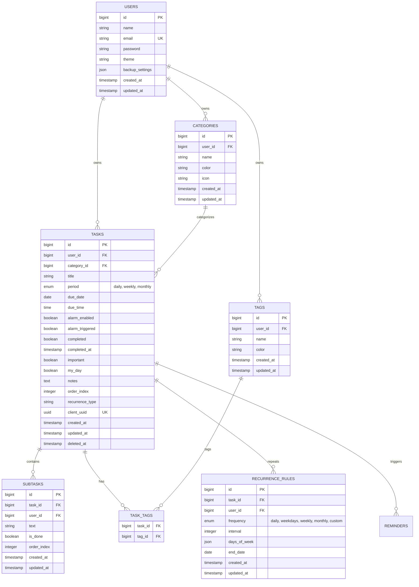

# TaskYar Web 2.0 — Data Model & Schema Specification

This document details the original client-side JSON data structure of TaskYar Desktop v1.1.0, the multi-tenant relational schema for MySQL/MariaDB in Laravel, the client-side IndexedDB model for offline PWA functionality, and the JSON import/export compatibility mapping.

---

## 1. Original Desktop v1.1.0 Data Structure

In TaskYar Desktop v1.1.0, data is persisted in browser `localStorage` as serialized JSON under the key `persian_todo_tasks`.

### 1.1. Task Object Schema
```json
{
  "id": 1729944000000,
  "title": "بررسی ایمیل‌ها و پیام‌های کاری صبحگاهی",
  "period": "daily",
  "dueDate": "2026-10-26",
  "dueTime": "09:30",
  "alarmEnabled": true,
  "alarmTriggered": false,
  "completed": false,
  "important": true,
  "myDay": true,
  "notes": "پاسخ به مشتریان اولویت‌دار",
  "subtasks": [
    { "text": "بررسی پنل کاربری", "done": true },
    { "text": "ارسال پیش‌فاکتورها", "done": false }
  ],
  "createdAt": "امروز"
}
```

### 1.2. Field Definitions in v1.1.0
- `id` (Integer / Number): Numeric timestamp (`Date.now()`).
- `title` (String): Task title.
- `period` (String): Time horizon category. One of `"daily"`, `"weekly"`, `"monthly"`.
- `dueDate` (String): Gregorian ISO date (`YYYY-MM-DD`). When empty, defaults to empty string `""`.
- `dueTime` (String): 24-hour time string (`HH:MM`). When empty, defaults to empty string `""`.
- `alarmEnabled` (Boolean): Flag indicating if audio/notification alarm is enabled.
- `alarmTriggered` (Boolean): Flag indicating whether the alarm has already fired for this schedule.
- `completed` (Boolean): Task completion status.
- `important` (Boolean): Starred task status.
- `myDay` (Boolean): Indicates whether the task belongs to today's list (`dueDate === todayISO`).
- `notes` (String): Additional notes or description.
- `subtasks` (Array of Objects): Each subtask has `{ "text": string, "done": boolean }`.
- `createdAt` (String): Human-readable Persian date string (e.g., `"امروز"` or formatted date).

### 1.3. Backup Settings Schema (`taskyar_backup_settings`)
```json
{
  "enabled": true,
  "folderPath": "C:\\Users\\...\\Documents\\TaskYar_Backups",
  "intervalMinutes": 30,
  "lastBackupTimestamp": 1729944000000,
  "lastBackupDate": "۱۴۰۵/۰۸/۰۲, ۰۹:۳۰:۰۰",
  "lastBackupFileName": "taskyar_autobackup_2026-10-26_09-30-00.json"
}
```

---

## 2. Web 2.0 Relational Database Schema (MySQL / MariaDB)

To support multiple users with strict privacy, data isolation, categories, tags, recurrences, and sync auditing, the Laravel backend uses the following relational tables.



### 2.1. Migration Tables Definition

#### `users` Table
```sql
CREATE TABLE users (
    id BIGINT UNSIGNED AUTO_INCREMENT PRIMARY KEY,
    name VARCHAR(255) NOT NULL,
    email VARCHAR(255) NOT NULL UNIQUE,
    password VARCHAR(255) NOT NULL,
    theme VARCHAR(50) DEFAULT 'default',
    backup_settings JSON NULL,
    remember_token VARCHAR(100) NULL,
    created_at TIMESTAMP NULL,
    updated_at TIMESTAMP NULL
) ENGINE=InnoDB DEFAULT CHARSET=utf8mb4 COLLATE=utf8mb4_unicode_ci;
```

#### `tasks` Table
```sql
CREATE TABLE tasks (
    id BIGINT UNSIGNED AUTO_INCREMENT PRIMARY KEY,
    user_id BIGINT UNSIGNED NOT NULL,
    title VARCHAR(500) NOT NULL,
    period VARCHAR(20) DEFAULT 'daily',
    due_date DATE NULL,
    due_time VARCHAR(10) NULL,
    alarm_enabled BOOLEAN DEFAULT FALSE,
    alarm_triggered BOOLEAN DEFAULT FALSE,
    completed BOOLEAN DEFAULT FALSE,
    completed_at TIMESTAMP NULL,
    important BOOLEAN DEFAULT FALSE,
    my_day BOOLEAN DEFAULT FALSE,
    notes TEXT NULL,
    order_index INT UNSIGNED DEFAULT 0,
    client_uuid VARCHAR(36) NULL,
    revision INT UNSIGNED DEFAULT 1,
    created_at TIMESTAMP NULL,
    updated_at TIMESTAMP NULL,
    deleted_at TIMESTAMP NULL,
    INDEX idx_user_due (user_id, due_date),
    INDEX idx_user_completed (user_id, completed),
    INDEX idx_user_important (user_id, important),
    INDEX idx_tasks_client_uuid (client_uuid),
    FOREIGN KEY (user_id) REFERENCES users(id) ON DELETE CASCADE
) ENGINE=InnoDB DEFAULT CHARSET=utf8mb4 COLLATE=utf8mb4_unicode_ci;
```

#### `subtasks` Table
```sql
CREATE TABLE subtasks (
    id BIGINT UNSIGNED AUTO_INCREMENT PRIMARY KEY,
    task_id BIGINT UNSIGNED NOT NULL,
    user_id BIGINT UNSIGNED NOT NULL,
    text VARCHAR(500) NOT NULL,
    is_done BOOLEAN DEFAULT FALSE,
    order_index INT UNSIGNED DEFAULT 0,
    client_uuid VARCHAR(36) NULL,
    revision INT UNSIGNED DEFAULT 1,
    created_at TIMESTAMP NULL,
    updated_at TIMESTAMP NULL,
    INDEX idx_task_order (task_id, order_index),
    INDEX idx_user_task (user_id, task_id),
    INDEX idx_subtasks_client_uuid (client_uuid),
    FOREIGN KEY (task_id) REFERENCES tasks(id) ON DELETE CASCADE,
    FOREIGN KEY (user_id) REFERENCES users(id) ON DELETE CASCADE
) ENGINE=InnoDB DEFAULT CHARSET=utf8mb4 COLLATE=utf8mb4_unicode_ci;
```

#### `categories` Table
```sql
CREATE TABLE categories (
    id BIGINT UNSIGNED AUTO_INCREMENT PRIMARY KEY,
    user_id BIGINT UNSIGNED NOT NULL,
    name VARCHAR(100) NOT NULL,
    color VARCHAR(20) DEFAULT '#6D28D9',
    icon VARCHAR(50) NULL,
    created_at TIMESTAMP NULL,
    updated_at TIMESTAMP NULL,
    FOREIGN KEY (user_id) REFERENCES users(id) ON DELETE CASCADE
) ENGINE=InnoDB DEFAULT CHARSET=utf8mb4 COLLATE=utf8mb4_unicode_ci;
```

#### `tags` & `task_tag` Tables
```sql
CREATE TABLE tags (
    id BIGINT UNSIGNED AUTO_INCREMENT PRIMARY KEY,
    user_id BIGINT UNSIGNED NOT NULL,
    name VARCHAR(100) NOT NULL,
    color VARCHAR(20) DEFAULT '#64748B',
    created_at TIMESTAMP NULL,
    updated_at TIMESTAMP NULL,
    FOREIGN KEY (user_id) REFERENCES users(id) ON DELETE CASCADE
) ENGINE=InnoDB DEFAULT CHARSET=utf8mb4 COLLATE=utf8mb4_unicode_ci;

CREATE TABLE task_tag (
    task_id BIGINT UNSIGNED NOT NULL,
    tag_id BIGINT UNSIGNED NOT NULL,
    PRIMARY KEY (task_id, tag_id),
    FOREIGN KEY (task_id) REFERENCES tasks(id) ON DELETE CASCADE,
    FOREIGN KEY (tag_id) REFERENCES tags(id) ON DELETE CASCADE
) ENGINE=InnoDB DEFAULT CHARSET=utf8mb4 COLLATE=utf8mb4_unicode_ci;
```

---

## 3. Client-Side Offline Model (IndexedDB)

For offline editing and instant local reactivity, the Vue frontend maintains an IndexedDB database named `TaskYarDB`:

### Object Stores
1. `tasks`: Keyed by local `client_uuid` or server `id`. Contains task fields, `sync_status` (`synced`, `pending_create`, `pending_update`, `pending_delete`), and `last_modified_timestamp`.
2. `subtasks`: Keyed by `id` or local UUID, indexed by `task_id`.
3. `categories`: Keyed by `id`.
4. `tags`: Keyed by `id`.
5. `sync_queue`: Ordered queue of mutations (`action`, `payload`, `timestamp`, `retry_count`) dispatched upon reconnect.

---

## 4. JSON Import/Export Compatibility Engine

To guarantee bidirectional compatibility with TaskYar Desktop v1.1.0:

### 4.1. Export Format (Web 2.0 -> v1.1.0 compatible)
When exporting to JSON, the Web 2.0 application serializes the user's tasks into the exact array schema expected by Desktop v1.1.0:
```json
[
  {
    "id": 1,
    "title": "بررسی ایمیل‌ها و پیام‌های کاری صبحگاهی",
    "period": "daily",
    "dueDate": "2026-10-26",
    "dueTime": "09:30",
    "alarmEnabled": true,
    "alarmTriggered": false,
    "completed": false,
    "important": true,
    "myDay": true,
    "notes": "پاسخ به مشتریان اولویت‌دار",
    "subtasks": [
      { "text": "بررسی پنل کاربری", "done": true },
      { "text": "ارسال پیش‌فاکتورها", "done": false }
    ],
    "createdAt": "۱۴۰۵/۰۸/۰۲"
  }
]
```

### 4.2. Import Parser (Desktop v1.1.0 -> Web 2.0)
The import routine accepts either an array of tasks or an envelope object `{ "tasks": [...] }`.
The import processor:
1. Validates each task item for `title`.
2. Normalizes `period` (defaults to `"daily"` if invalid).
3. Normalizes `dueDate` (validates `YYYY-MM-DD` or sets `null`).
4. Normalizes `dueTime` (validates `HH:MM` or sets `null`).
5. Converts subtask items `{ text, done }` into relational child records.
6. Enforces that all newly imported records are associated with the authenticated `user_id`.
