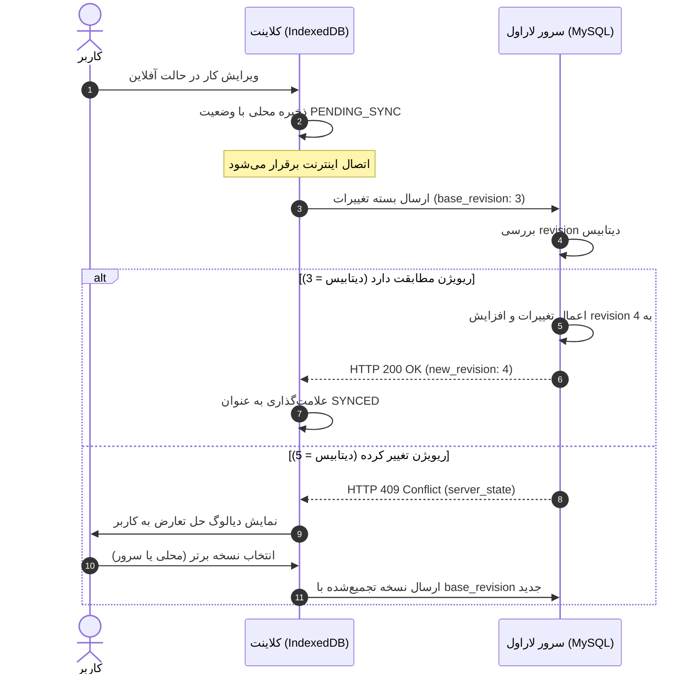

# TaskYar Web 2.0 — Offline Synchronization Architecture Specification

**Status:** Design Specification (Prepared for Future Phase Implementation)  
**Target Architecture:** Vue 3 PWA + IndexedDB client-side store with Laravel REST API on Shared Hosting.  
**Strict Mandate:** Conflict-aware synchronization, zero silent data loss, zero permanent background daemons.

---

## 1. Core Principles of the Sync Protocol

1. **Client-Generated UUIDs:** Every task and subtask is assigned a RFC 4122 v4 UUID (`client_uuid`) upon client creation. The client never waits for server auto-increment IDs to render or link relational children.
2. **Revision Tracking & Optimistic Concurrency:** Every record carries an integer `revision` (starting at `1`). Mutations increment this revision. If a client attempts to update a record with an outdated base revision, the server rejects the mutation with an **HTTP 409 Conflict** response, preventing silent overwrites.
3. **Idempotency:** Every mutation payload includes an idempotency key (typically the mutation UUID). If a network glitch causes a retry of an already applied mutation, the server acknowledges it safely without duplicate operations.
4. **Soft Deletions:** Deletions are marked via `deleted_at` timestamps. Clients pulling updates receive tombstone records to delete them from local IndexedDB storage.
5. **Per-Account Local Storage Isolation:** IndexedDB databases are segmented per user ID (`TaskYarDB_{userId}`). When a user logs out or switches accounts, uncommitted mutations and cached records for that account are either cleared or strictly isolated.

---

## 2. Data Contract & Schema Extensions

### 2.1. Server Database Columns
- `client_uuid`: `VARCHAR(36) NULL, INDEX` on `tasks` and `subtasks`.
- `revision`: `INT UNSIGNED NOT NULL DEFAULT 1` on `tasks` and `subtasks`.

### 2.2. Mutation Payload Format (Client -> Server)
```json
{
  "mutation_id": "9b1deb4d-3b7d-4bad-9bdd-2b0d7b3dcb6d",
  "client_uuid": "e2c0b784-5f16-43b2-9a3b-1b2a3c4d5e6f",
  "action": "update",
  "base_revision": 3,
  "changes": {
    "title": "بررسی نهایی گزارش مالی",
    "completed": true
  },
  "client_timestamp": 1729944000000
}
```

### 2.3. Server Response Format
#### Success (HTTP 200 / 201)
```json
{
  "success": true,
  "mutation_id": "9b1deb4d-3b7d-4bad-9bdd-2b0d7b3dcb6d",
  "client_uuid": "e2c0b784-5f16-43b2-9a3b-1b2a3c4d5e6f",
  "new_revision": 4,
  "task": {
    "id": 42,
    "client_uuid": "e2c0b784-5f16-43b2-9a3b-1b2a3c4d5e6f",
    "revision": 4,
    "title": "بررسی نهایی گزارش مالی",
    "completed": true,
    "updated_at": "2026-10-26T14:30:00Z"
  }
}
```

#### Conflict Detected (HTTP 409 Conflict)
```json
{
  "error": "conflict_detected",
  "message": "این کار در دستگاه دیگری تغییر یافته است.",
  "client_uuid": "e2c0b784-5f16-43b2-9a3b-1b2a3c4d5e6f",
  "client_revision": 3,
  "server_revision": 5,
  "server_state": {
    "id": 42,
    "revision": 5,
    "title": "بررسی نهایی گزارش مالی (ویرایش شده در وب)",
    "completed": false,
    "updated_at": "2026-10-26T14:28:00Z"
  }
}
```

---

## 3. Conflict Resolution Workflow



When a conflict occurs:
1. The client **never** silently discards user edits.
2. The user is presented with a non-blocking conflict resolution modal showing both versions (field diff).
3. The user can choose:
   - **نگه‌داری تغییرات محلی (Keep My Changes):** Re-applies the local edit on top of the latest server revision.
   - **پذیرش تغییرات سرور (Keep Server Version):** Discards local pending changes and adopts the server record.
   - **ترکیب دستی (Merge):** Allows editing title, notes, or schedule to preserve both contents.

---

## 4. Local Data Security & Multi-User Partitioning

1. **Isolated IndexedDB Names:** Database name is keyed by user ID: `TaskYarDB_{user_id}`.
2. **Account Switching / Logout Handling:**
   - Upon `logout`, all memory states in Pinia are reset.
   - The user's IndexedDB connection is closed.
   - Any guest or temporary session data is purged.
3. **Sensitive Field Encryption:** Notes and titles stored in IndexedDB can optionally be encrypted using the Web Cryptography API (`AES-GCM`) keyed to the user session.
