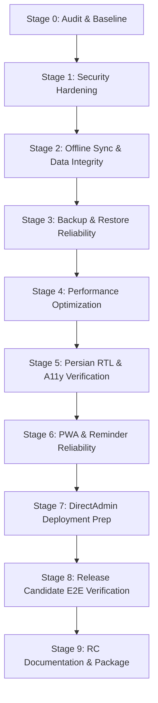

# TaskYar Web 2.0 — Phase 6: Production Readiness, Security, Performance & Release Candidate
## Comprehensive Implementation Plan & Baseline Audit

**Document Version:** 1.0.0  
**Date:** October 28, 2026  
**Status:** In Progress — Stage 0 Baseline Established  

---

## 1. Executive Summary & Baseline Status

Phase 6 hardens TaskYar Web 2.0 for enterprise-grade reliability and seamless production deployment on conventional shared hosting environments (specifically DirectAdmin-based hosting with PHP 8.3+, MySQL/MariaDB, Apache/LiteSpeed, without requiring root access, Docker, or persistent Node.js/Redis processes).

The Phase 5.1 UI stabilization baseline (mirrored Persian text, oversized search icon, recurrence interface styling, and dropdown consistency) is fully preserved.

### 1.1 Baseline Test Results (Pre-Modification)

| Test Suite | Engine | Tests | Assertions | Status |
| :--- | :--- | :---: | :---: | :---: |
| Backend Feature & Unit Tests | PHPUnit 12.5 (PHP 8.4) | 41 | 608 | **PASSED** (2.01s) |
| Jalali Calendar & Digit Tests | Node.js Test Runner | 8 | 100+ | **PASSED** (0.12s) |
| Offline Persian Natural-Language Parser | Node.js Test Runner | 7 | 25+ | **PASSED** (0.11s) |
| Frontend Production Compilation | Vite 8.3 / Vue 3.5 | 125 mods | — | **PASSED** (1.26s) |

---

## 2. Identified Vulnerabilities, Risks & Architectural Flaws

During our comprehensive Stage 0 code and security audit, several critical flaws were uncovered across authentication, data isolation, sync, backup, and performance:

### 2.1 Multi-User Data Isolation Flaws (Security High Priority)
1. **Cross-Account Category Injection in Tasks:**
   - In `TaskController::store` and `update`, validation for `category_id` was simply `['nullable', 'integer', 'exists:categories,id']`.
   - **Flaw:** A user could submit another user's `category_id`, linking their task to a category belonging to a different account.
   - **Remedy:** Validate with `Rule::exists('categories', 'id')->where('user_id', $userId)`.
2. **Cross-Account Tag Attachment in Tasks:**
   - In `TaskController::update`, when receiving numeric tag IDs in `tags`, the controller passed `$tagIds` directly to `$task->tags()->sync($tagIds)` without verifying `where('user_id', $userId)`.
   - **Flaw:** User B could attach User A's private tags to their tasks.
   - **Remedy:** Filter tag IDs through `Tag::where('user_id', $userId)->whereIn('id', $tagIds)->pluck('id')`.
3. **Missing Category Policy / Show Method:**
   - `Route::apiResource('categories', ...)` registered `categories.show`, which had no explicit ownership authorization handler.
4. **Permissive Authentication Rate-Limiting:**
   - `api/auth/login` and `api/auth/register` were throttled to `throttle:60,1` (60 attempts/min).
   - **Remedy:** Tighten login throttling to `throttle:10,1` to prevent brute force and credential stuffing.
5. **Session Secure Cookies & HTTPS Handling:**
   - `config/session.php` had `secure` set to `env('SESSION_SECURE_COOKIE')`, defaulting to `null` instead of enforcing `true` in production when HTTPS is enabled.

### 2.2 Offline Synchronization & Route Mismatches (Data Integrity)
1. **Route Name Mismatch on Recurrence Actions:**
   - In `routes/web.php`, occurrence actions are defined as:
     - `POST /api/tasks/{task}/occurrences/{date}/toggle-complete`
     - `POST /api/tasks/{task}/occurrences/{date}/skip`
     - `POST /api/tasks/{task}/occurrences/{date}/edit-this`
     - `POST /api/tasks/{task}/occurrences/{date}/edit-future`
   - In `resources/js/stores/tasks.js`, `editThisOccurrence` and `editFutureOccurrences` were dispatching to `/api/tasks/{task}/recurrence/edit-this` and `/api/tasks/{task}/recurrence/edit-future`.
   - **Flaw:** Disconnect led to 404 Not Found on occurrence mutations from the frontend.
   - **Remedy:** Align store URLs and register backward-compatible route aliases.
2. **Unhandled Mutation Types in `SyncController.php`:**
   - In `SyncController.php`, validation accepted `create_category` and `delete_category`, but the execution `switch ($type)` only handled task operations.
   - **Remedy:** Implement category mutations in `SyncController.php`.
3. **Category ID Scoping in Sync Mutations:**
   - `SyncController::update_task` accepted `category_id` without confirming user ownership.
4. **Session Expiration Graceful Recovery:**
   - In `client.js`, 401 responses threw generic exceptions without triggering auth modal or re-authentication prompt.
5. **Logout with Unsynchronized Mutations:**
   - Prompting the user before logout if `pendingSyncCount > 0` to prevent accidental orphaned client state.

### 2.3 Backup and Restore Gaps (Data Integrity)
1. **Recurrence Exceptions & Advanced Reminders Missing from Export/Import:**
   - `BackupController::export` did not include `reminder_offset_minutes`, `snooze_until`, or records from `task_recurrence_exceptions` (e.g. skipped or completed occurrences).
   - **Flaw:** Restoring a backup lost recurrence progress and custom reminder offsets.
   - **Remedy:** Include reminder parameters and recurrence exceptions in V2 envelope schema and import handler.
2. **Missing Backup Payload Size Boundaries:**
   - No validation on file size or maximum tasks imported in a single transaction (DoS vector).
   - **Remedy:** Limit backup upload to 10MB and max 5,000 tasks per import.

### 2.4 Performance Bottlenecks
1. **Analytics N+1 Database Query Loop:**
   - `AnalyticsController::index` ran individual queries for each of the last 7 days (21 queries) and 6 months (18 queries), totaling ~45 sequential DB queries per analytics view.
   - **Remedy:** Batch using `GROUP BY DATE(completed_at)` and single windowed aggregations.
2. **Iconsax Massive Bundle Size:**
   - `import 'iconsax'` in `app.js` bundled unused icon sets (e.g., 2MB christmas JSON, 853KB crypto JSON), outputting >8MB of unnecessary build assets.
   - Since `AppIcon.vue` and `iconsaxData.js` already provide self-contained inline SVG vectors for all needed icons, trimming the bulk bundle cuts distribution size drastically.
3. **Missing Composite Database Indexes:**
   - `tasks` queries frequently filter on `['user_id', 'client_uuid']` and `['user_id', 'due_date', 'due_time']`. Adding targeted indexes will accelerate shared hosting query response.

---

## 3. Stage-by-Stage Implementation Roadmap

### Stage 1: Security Hardening
- [ ] Enforce strict user ownership validation on `category_id` in `TaskController::store`, `TaskController::update`, and occurrence endpoints.
- [ ] Enforce user ownership on synced tags in `TaskController`.
- [ ] Implement `CategoryPolicy` and add explicit ownership check on `categories.show`.
- [ ] Tighten auth rate limits on login/register endpoints to `throttle:10,1`.
- [ ] Configure secure cookies and session security for production.
- [ ] Handle 401 session expiration gracefully in `client.js`.
- [ ] Write regression tests for all cross-account isolation vectors in `tests/Feature/SecurityHardeningTest.php`.

### Stage 2: Data Integrity & Offline Synchronization Audit
- [ ] Fix recurrence endpoint route alignments between `routes/web.php` and `resources/js/stores/tasks.js`.
- [ ] Implement `create_category` and `delete_category` in `SyncController.php`.
- [ ] Ensure `SyncController` validates category ownership.
- [ ] Ensure logout warns if unsynchronized changes exist while safely preserving user's IndexedDB.
- [ ] Add regression tests in `tests/Feature/OfflineSyncAndReminderTest.php`.

### Stage 3: Backup & Restore Reliability
- [ ] Add `reminder_offset_minutes`, `snooze_until`, and `recurrence_exceptions` to V2 export.
- [ ] Update `BackupController::import` to restore recurrence exceptions and reminders atomically.
- [ ] Enforce 10MB file limit and bounded items count (max 5,000 tasks).
- [ ] Create automated round-trip tests covering tasks, subtasks, categories, tags, recurrence exceptions, and reminders.

### Stage 4: Performance Optimization
- [ ] Refactor `AnalyticsController.php` to use batched aggregations instead of 45 sequential queries.
- [ ] Optimize Iconsax bundle in Vite by leveraging clean vector trees.
- [ ] Add migration for optimized composite indexes `['user_id', 'client_uuid']`.
- [ ] Run benchmarks with 100, 1,000, and 5,000 tasks.

### Stage 5: Persian RTL & Accessibility Audit
- [ ] Verify zero horizontal scrollbars, proper Jalali dates, and Persian digits across viewports (375x812, 768x1024, 1280x800, 1440x900).
- [ ] Audit focus rings, keyboard accessibility, modal Escape handling, and color contrast.

### Stage 6: PWA and Reminder Reliability
- [ ] Audit Service Worker cache invalidation and offline shell behavior.
- [ ] Verify multi-account isolation in PWA context (no shared cache leakage).
- [ ] Document in-app vs system notification capabilities truthfully.

### Stage 7: DirectAdmin Shared Hosting Deployment Preparation
- [ ] Create `docs/DIRECTADMIN_DEPLOYMENT_GUIDE.md` covering standard and restricted docroot environments.
- [ ] Create `docs/PRODUCTION_ENV_CHECKLIST.md`.
- [ ] Create `docs/ROLLBACK_AND_RECOVERY.md`.

### Stage 8: Release Candidate Verification
- [ ] Run full automated test suite (`php artisan test`, unit tests, e2e tests).
- [ ] Validate complete 20-step user journey.

### Stage 9: Release Candidate Package & Documentation
- [ ] Create all final Phase 6 reports and checklists.
- [ ] Tag TaskYar Web 2.0 RC1 baseline.
